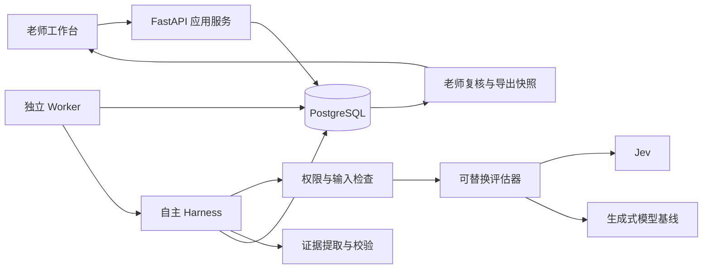
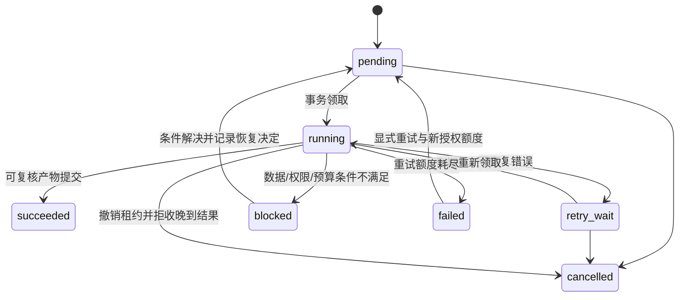

# 架构与可行性审查

日期：2026-10-19。
状态：本文件保留最初架构建议，后续实际交付与验收以 [实施记录](IMPLEMENTATION_STATUS.md) 为准。Harness 已发展到 [v5](HARNESS_V5_2026-10-22.md)，增加可恢复上下文、子任务、问答、记忆、预算及 SSE；现有工作台仍使用有限轮询，新的 SSE 接口可按数据库游标续传。不能把本文全部长期产品能力视为已交付；用户决定以 [项目长期记忆](PROJECT_MEMORY.md) 为准。

## 1. 判断：工程可实施，教学收益尚待验证

建议采用“版本化教学业务 + 可恢复的固定批改工作流 + 可替换评估器”。首版从老师的批改工作台开始，先解决一份作业的初评、复核与导出。

| 需要判断的可行性 | 当前结论 | 尚需取得的证据 |
| --- | --- | --- |
| 文本简答题的版本、初评、复核、导出 | 适合关系模型与明确工作流，工程上可实施 | 最小链路及数据库集成测试 |
| 自主 Harness 支持重试、中断恢复、预算和权限 | 可以用 PostgreSQL 事务、租约、回执和状态机实现 | 故障注入，尤其旧实例回写、并发复核和提交临界点 |
| Jev 的 Score 接入 | 文档接口适配这种分项判断 | 账户级契约测试、可用模型版本和中文真实样本 |
| Jev 提高评分质量或降低成本 | 目前不能判定 | 与普通模型的同条件对照，包含证据提取及老师复核的总成本 |
| 自动生成完整评分证据 | Jev Score 本身不提供引用文本；需另建流程 | 提取定位测试、老师对证据支持性的标注 |
| 跨作业学习分析 | 可以保留必要关联，后续用 SQL 计算 | 知识点映射、历史成员关系、可比评分口径和订正数据 |
| 多 Agent、长期记忆、自主心跳 | 当前批改闭环没有必须引入的理由 | 具体跨任务依赖、持续等待和资料复用场景 |

最需要先验证的不是“能否调用模型”，而是：评分细则能否被可靠操作化、错误是否能被发现、老师复核是否省时、失败后是否保持正确业务状态。

EchoMind 仅提供部分实现思路。教学助手的核心组织单位是作业、答案版本、评分点、复核和任务，不沿用客服问答的意图分类与角色分派。

## 2. 首版的业务与 Harness 边界

业务层拥有规则和事实；Harness 执行经过授权的步骤；模型提供待验收的判断或草稿。

| 层 | 负责 | 不负责 |
| --- | --- | --- |
| 教学领域 | 作业、题目、细则、版本、学生、课程、成员历史、计分、复核、结果选择 | 供应商协议、重试时序 |
| 应用服务 | 创建批次、绑定版本、导入、重评计划、复核提交、导出快照 | 自行猜测评分规则 |
| Harness | 上下文装配、活动执行、检查点、预算、超时、取消、恢复和 trace | 修改已确认细则、替老师确认成绩 |
| Policy | 操作者、课程、对象、工具、参数及权限撤销检查 | 根据学生答案授予权限 |
| Model Adapter | 请求/响应转换、模型标识、用量、错误分类和取消协作 | 独立提交最终成绩 |
| Verifier | schema、版本、完整性、范围、证据位置、计分一致性；语义问题分流 | 用格式正确来证明评分正确 |
| 老师工作台 | 查看证据、修订等级/分数、说明例外、确认和导出 | 将未确认建议冒充最终成绩 |

API 与 Worker 调用同一组应用服务和领域规则。未来即使增加对话式入口，助手也只能通过这些服务工作。



这是一个代码仓库、一个主数据库、两个运行进程入口的模块化单体。暂不拆微服务。

## 3. 对默认技术草案的取舍

| 技术 | 建议 | 理由与边界 |
| --- | --- | --- |
| PostgreSQL | 已确认，保持 | 唯一业务事实和持久执行状态来源 |
| Python | 推荐 | 模型 Client、结构化验证、数据处理与 asyncio 可在一个后端内完成 |
| FastAPI + Pydantic | 推荐 | API 契约、请求验证及老师工作台后端；不依赖进程内 BackgroundTasks 保证批改恢复 |
| SQLAlchemy 2 + asyncpg + Alembic | 推荐 | 显式事务、迁移、约束；并发活动各用独立 AsyncSession |
| asyncio + 自研状态机 | 推荐，范围限于本项目需要 | 固定步骤、有限重试、租约、检查点；不实现通用工作流 DSL |
| Celery + Redis | 首版暂缓 | 当前没有高并发依据；先避免业务写库和队列投递的一致性负担 |
| PostgreSQL 任务表 | 推荐作为首版投递机制 | 业务写入与待执行项同事务；Worker 轮询领取，支持恢复扫描 |
| React + TypeScript + Vite + Ant Design | 保留推荐 | 适合细则表单、答案高亮、复核列表；不要求另建聊天界面 |
| SSE | 工作台阶段加入 | 推送状态变化；断线后从数据库补查，SSE 不是事实存储 |
| CSV / openpyxl | 文件格式暂不定 | 先固定内部答案契约，拿到真实样例后选择一个导入器 |
| 本地文件 | 首版可行 | 原始导入、导出、受限的大产物；数据库保存内容摘要与关联，跨主机再迁移对象存储 |
| pytest / pytest-asyncio | 推荐 | 领域测试及真实 PostgreSQL 上的故障测试 |
| Locust | 在正确性验收后使用 | 模拟模型先压测，再少量真实调用，不预设性能数字 |
| uv / Ruff / Docker Compose / CI | 推荐，依赖版本在工程启动时锁定 | 可复现环境；Compose 是开发部署选择，不是必须现在安装 |
| pgvector | 后续按需 | 精确 ID 查询先使用普通关系查询；不为首版评分引入检索依赖 |

PostgreSQL 的 `FOR UPDATE SKIP LOCKED` 适用于队列领取，不应用于成绩报表；AsyncSession 不能在并发任务间共享。见 [PostgreSQL](https://www.postgresql.org/docs/current/sql-select.html) 和 [SQLAlchemy](https://docs.sqlalchemy.org/en/20/orm/extensions/asyncio.html#using-asyncsession-with-concurrent-tasks)。

如果后来测到队列轮询压力、需要独立扩缩 Worker 或复杂路由，再引入 Celery。届时采用“业务事务写 outbox → 投递器发送 → Worker 领取数据库任务 → 幂等提交”的方式；消息只是唤醒信号。Celery 的重投递不能替代业务幂等与恢复扫描。[Celery Tasks](https://docs.celeryq.dev/en/stable/userguide/tasks.html)

## 4. 评分规则、模型输出和程序计分

### 4.1 固定的输入包

每次评分必须能还原以下对象：

- 服务端绑定的老师/课程授权范围。
- `question_version_id`、题干、固定参考答案及允许使用的材料版本。
- `submission_version_id`、原始答案字符串和内容摘要。
- `rubric_version_id`、评分点的语义版本、等级描述与排列。
- 模型、提示、适配器、选择策略、证据策略和校验器的版本。

不加入学生历史分数、姓名、班级排名或与本次评分无关的个人画像。身份关联留在业务库，模型只获得完成判断必要的数据。

材料必须先由老师纳入固定评分依据。首版不让模型临时上网搜索或任意检索来改变评分口径。

### 4.2 一个评分点只评价一个维度

`criterion_version` 保存评分意图、可独立理解的等级描述和适用条件；分值映射保存在固定 rubric 版本中。

初期建议候选选择规则为分布的唯一最大项，即 `argmax`；并列时不自动选分，记录 `ambiguous_level`。这是需要随细则确认的本项目规则，不是 Jev 的学生评分规则。

程序按老师确认的 `level_id → points` 表计算分项分数，并用 Decimal / PostgreSQL NUMERIC 累加。不能对 Jev 连续 Score 四舍五入后直接当作学生得分，也不能未经确认使用概率加权成绩。

例如，假设某评分点的三个等级分别映射到 0、1、3 分。若分布为 `(0.10, 0.35, 0.55)`，按上述候选规则得到第三档，建议分为 3。模型序号加权值为 1.45；二者不同。这只是计分规则示例，不代表任何学科的真实样本或准确性。

缺失或无法选择的评分点保持空值；可以展示“已完成部分小计”，但不能把它包装成完整总分，也不能以零分替代失败。

### 4.3 适配器应保留的区别

- `JevScoreEvaluator`：保留 provider score、原始概率分布、confidence 和实际返回模型；适配为内部等级。
- `GenerativeEvaluator`：对相同输入输出候选等级和结构化理由，作为基线；没有供应商支持的分布时相应字段为空。
- `FakeEvaluator`：返回固定 fixture 或模拟超时、限流、错 schema，仅用于工程测试，界面与导出明确标识。
- `EvidenceExtractor`：生成原文片段候选；不是事实判定器。

Jev 的接口事实与限制见 [参考审查](REFERENCE_AUDIT.md)。真实供应商故障时不静默切换到另一模型混入同一评估配置；切换形成显式配置或新的执行版本。

## 5. 证据设计：存在与支持分别记录

建议先让评分器读取完整原答案独立判断，再让证据提取器读取同样的原文和评分点，但不传候选等级，减少为了某个已知分数寻找理由的倾向。二者的质量仍需分别评测。

一条有效引用至少保存：

```text
submission_version_id
answer_sha256
quote
start_codepoint, end_codepoint       # 左闭右开
extractor_call_id / human_review_id
location_check                     # verified / invalid
support_check                      # unverified / machine_supported /
                                   # machine_conflict / teacher_supported /
                                   # teacher_rejected / not_applicable
```

位置检查由程序执行：`stored_answer[start:end] == quote`。答案在入库后不做隐式 trim、大小写转换、Unicode 归一化或换行改写。导入原文件另存，解析后的答案字符串就是本次定位权威文本。

模型可返回 quote 与候选定位；程序只接受精确对应。重复片段有多处位置时保存明确位置或待消歧标志，不擅自认定第一处就是模型所指。Python 的字符索引与前端 JavaScript 的 UTF-16 索引不同，API 必须声明按 Unicode code point，并由前端按同一规则高亮；emoji 等边界纳入测试。

位置正确只说明引用存在。首版的语义支持检查由老师复核承担，保存判定与必要原因；后续可试验额外模型检查，但“机器认为支持”不自动升级为“老师确认”。

对于“未提到某要点”，没有局部片段能证明全文不存在该要点。允许空 evidence 列表与 `absence_claim`，明确要求查看完整答案；不补造引用。空白答案、截断、否定句、前后矛盾、同义表达分别保留问题标记。

证据或原始输出不合格时保留诊断信息，但不将无效引用写为已验证证据。

## 6. 推荐数据模型

### 6.1 版本与关键关系

不可变的题目、答案、细则、模型观察和复核记录是事实。当前状态、计数和“当前复核”指针是可重建的投影。JSONB 可保存原始响应、参数和问题列表，但主键、外键、版本、状态和分数使用明确列与约束。

| 组 | 建议实体 | 核心关系与约束 |
| --- | --- | --- |
| 身份与教学组织 | `teacher`, `course`, `course_access`, `classroom`, `student`, `class_membership` | 课程访问有角色和有效期；班级成员保留加入/退出历史 |
| 作业参与范围 | `assignment`, `assignment_participant` | 作业绑定课程/班级；参与名单形成快照，区分未提交与不在样本内 |
| 题目 | `question`, `question_version` | 题干、参考答案、材料引用不可变；版本唯一 `(question_id, version_no)` |
| 细则 | `rubric_version`, `criterion_version`, `rubric_criterion`, `rubric_level_points` | rubric 绑定题目版本；评分点可被多个 rubric 版本引用；等级映射固定 |
| 答案 | `submission`, `submission_version`, `import_record` | 此处一份 submission 指一位学生对一道题的答案；版本绑定作业、参与者和题目版本 |
| 评估配置 | `evaluation_profile` | 固定评估器、模型/提示、证据策略、选择规则、校验版本及参数摘要 |
| 批次与待评对象 | `grading_batch`, `grading_batch_item`, `grading_item` | 批次固定版本和选择范围；关联表支持重复请求复用同一待评对象 |
| 分项观察 | `criterion_assessment`, `assessment_evidence`, `evidence_check` | 原始语义判断、引用及检查来源独立可追溯；不被老师修改覆盖 |
| 本次计分 | `grading_item_criterion` | 引用 assessment，按本 rubric 映射计算建议分；记录复用来源 |
| 复核 | `teacher_review`, `teacher_review_item` | 追加修订；记录所见结果版本、最终等级、分数例外、理由及操作者 |
| 持久执行 | `task_run`, `task_step`, `execution_attempt`, `model_call` | item 对应一个 run；run 有租约/代次；step 保存检查点；调用保存用量及错误 |
| 幂等与审计 | `operation_receipt`, `domain_event`, `audit_event` | 请求摘要、结果引用、变更原因与发起者；和业务修改同事务 |
| 导出 | `export_snapshot`, `export_row`, `artifact` | 固定导出时的 result/review 版本与状态；文件内容摘要可验证 |
| 分析扩展 | `knowledge_point`, `criterion_knowledge_link`, `correction_link` | 评分点关联有版本；订正显式链接原答案与新答案，后续迭代实现 |
| 长期知识扩展 | `material_version`, `teaching_memory`, `embedding_index` | 来源、范围、确认和有效期；向量只作为派生索引，后续实现 |

这是逻辑模型，不要求第一条纵向链路同时实现所有扩展表。第一阶段固定组织身份、版本、评估、复核和执行关联；订正、长期知识和向量模块按真实任务建设。

### 6.2 必须从最初迁移建立的不变量

1. 已确认 rubric 的语义、等级、分值和引用不能原地改写；新修改产生新版本。
2. `rubric_version.question_version_id` 与评估目标的题目版本一致。跨课程外键还需校验所属范围，不仅检查 UUID 是否存在。
3. `(teacher_scope, operation_name, idempotency_key)` 唯一；相同 key 但请求摘要不同返回冲突。
4. `grading_item` 的有效身份由答案版本、rubric 版本、评估配置和显式 `generation` 确定；默认 generation 不因重试递增。
5. 批次中同一答案目标不得出现两次；跨批次复用已有对象时使用关联，不复制有效评估。
6. `task_step(run_id, step_key)` 唯一，accepted 输出只能在持有当前租约与代次的事务中创建。
7. 分项结果必须属于当前 rubric 中实际存在的评分点；不能遗漏、重复或混入其他版本。
8. 最终分数只能来自明确的老师确认记录；老师覆盖某分项分数必须有原因并在有效范围内。
9. 复核追加使用乐观并发版本；读取旧版本的第二次修改不能覆盖第一位老师已经提交的修改。
10. 导出指向固定的复核与结果版本；未确认分数为空或放在单独的建议列。

跨行约束，例如满分等于各分项满分之和，在冻结细则的事务中检查；需要跨表一致性时配合组合外键、受控写路径或触发器。不能用一个只检查 JSON 类型的约束替代这些业务规则。

## 7. 执行状态与老师确认状态分离

### 7.1 单份答案的执行

`grading_item` 与 `task_run` 一对一。单份答案的执行状态持久化在 `task_run.state`，不再维护另一个可独立修改的同义状态列。



`succeeded` 只说明批改活动产出了结构完整、可供老师检查的草稿，可能包含弃判、无证据或争议标记；不表示评分正确或已经确认。评分点结构缺失与模型网络失败不能伪装成正常弃判。

老师复核另有 `pending → confirmed`；修改已确认结果创建新的 review revision，旧记录仍可查询。等待老师时不占用 Worker 租约。

### 7.2 批次

批次持久化 `execution_state = queued | running | blocked | settled | cancelled`，另存结果计数和 `review_state = pending | partial | confirmed`。

当所有成员均已结束执行，批次进入 `settled`，并记录 `outcome = all_succeeded | partial_failure | all_failed`。存在预算/配置阻塞且没有可运行成员时为 `blocked`。失败项被显式重试后，批次可重新进入 running，事件记录该变化。

批次和单项状态同事务更新；最终结算通过短暂锁住批次行后重新读取成员状态完成，不能仅用“计数 +1”猜测是否全部结束。恢复扫描能重新计算投影。

跨批次共享 grading_item 时，取消一个批次只取消它的关联；没有其他有效消费者时才取消底层 run。创建关联与取消都先锁同一目标行，避免遗漏并发消费者。

## 8. 任务领取、回写与恢复

Worker 轮询 PostgreSQL，选取到期任务，用 `FOR UPDATE SKIP LOCKED` 在短事务内领取：

1. 设置运行状态、`lease_owner`、`lease_expires_at`，递增 `lease_epoch`。
2. 新增 execution_attempt，记录本次代次和输入/配置摘要。
3. 提交事务后才请求模型。模型调用期间不占数据库行锁。
4. 每个阶段提交时重新检查 `state=running`、owner、epoch、租约未过期及取消状态。
5. 校验成立后，结果、检查点、操作回执、事件和必要投影同事务写入。

失效 Worker 即使收到成功响应，也不能提交有效结果。可以把其调用结局记为 `stale_discarded` 用于成本追踪；它不能更新检查点、成绩或老师复核。

使用数据库时间判断租约，避免不同主机时钟决定所有权。续租也必须校验 epoch；续租失败时停止发起后续调用。恢复扫描处理超期租约、遗漏的 ready 步骤、待重试项及未完成导出。

租约、续租周期和单次调用超时作为一组配置校验：续租间隔必须明显短于租约，调用需有独立超时，Worker 退出时停止领取新任务。不能靠不断续租把一个永久挂起的调用保活。

幂等有三层：API 请求回执、业务评估身份、步骤结果的代次校验与唯一约束。不能只用 Redis SETNX 或内存集合。

本系统可保证“只有一份被接受的有效业务结果”，不能承诺外部模型只调用或收费一次：模型已执行而本地未收到响应时，重试可能重复计费。记录这种 unknown 结局并纳入预算与评测。

## 9. 局部重评

先区分两类修改：

| 修改 | 建议处理 |
| --- | --- |
| 仅等级到分数映射改变，语义输入完全相同 | 新 rubric / grading_item，复用原分布与候选等级，程序重新计分；重新确认 |
| 一个评分点的等级语义改变 | 只重评该点，其他点通过显式来源引用复用 |
| 题干、答案、全局规则或共享参考材料改变 | 重评所有依赖改变输入的评分点；首版保守按整题处理 |
| 模型、评分提示或适配器行为改变 | 形成新的评估配置，重跑受影响的判断 |
| 证据提取提示改变 | 保留相同条件下的语义判断，重新提取/检查证据 |
| 知识点标签改变 | 保留评分事实，新增分析映射版本；不回写旧报表口径 |

复用依据是实际输入依赖和内容摘要，不是“评分点名字没变”。使用 SHA-256 的输入摘要，规范化仅指 JSON 字段顺序等序列化形式，不改写答案字符串。摘要包含相关题目/材料内容、答案版本、评分点语义、模型与提示版本；另存来源 ID 供审计。

未经变化的评分点引用原 assessment，不能伪装成新模型调用；新 rubric 下的总分和老师确认重新生成。原 rubric、旧结果和旧 review 都保留。

## 10. 首版 Harness 的实现范围

| 机制 | 首版工作 | 对应失败场景或验收 |
| --- | --- | --- |
| Model Adapter | Jev、普通模型、模拟评估器的统一结果/错误/用量 | 超时、限流、错 schema、供应商切换可追溯 |
| Agent Runtime | 先实现固定活动执行器；定义模型输出/工具请求边界 | 活动结束不等于业务完成；未通过验证不得入最终结果 |
| Tool Registry / Executor | 小型代码注册表、输入/输出 schema、超时、权限和回执 | 非白名单工具、非法参数和跨课程对象被拒绝 |
| Policy | 服务端身份、课程访问、对象/参数范围、提交时再次检查 | 猜到其他课程 ID 仍无法读取或确认 |
| Durable Runtime | task/run/step/attempt、租约、恢复与幂等 | kill Worker、晚回写、重复请求 |
| Context | 固定版本输入包、预算、原文引用、注入边界 | 不混入历史分数；答案不能修改规则 |
| Memory | 首版只保存业务与上下文事实；长期经验另列后续 | 老师一次修改不扩散为全局规则 |
| Orchestrator | 批次 fan-out 为独立持久任务，不创建自主子 Agent | 单项失败不拖垮其他答案 |
| Skills | 固定版本的批改流程说明和提示资源 | 运行中不随文件修改更换口径；说明不拥有权限 |
| Event / Heartbeat | 事务事件及基础设施恢复扫描 | 丢失唤醒后仍能扫描到任务；不建立产品定时助手 |
| Sandbox | 暂缓通用代码执行；输入只按数据解析 | 无需向模型提供 Shell 或任意 SQL |
| Verifier / Evaluation | 确定性校验 + 老师评测 + 故障测试 | 格式合格但语义错误仍可被发现 |
| Trace | 贯通操作、批次、run、step、attempt、model_call | 用量、失败原因和结果来源能串联 |

Hook 是受控生命周期扩展点。强制的授权、冻结版本检查、分数计算和提交代次校验不允许通过关闭 Hook 绕过。初期只实现实际需要的 before_activity、after_activity 和 on_failure；不为凑齐模块先搭十几个空框架。

预算至少约束单次超时、最大活动调用数、总重试数、输入输出规模和任务截止条件。并发调用先在数据库预留额度，再发请求；结束后结算。供应商未回应用量时标记 unknown 并保守保留预留值。预算用于约束新调用，不能声称它能撤销已经发生的外部计费。

## 11. 复核、导出与学习分析

老师的复核对象必须绑定不可变 grading_item 和其版本。修改最终等级后由程序重算分数；允许个别分数例外时单独记录 override 和理由，不篡改分值映射。

导出先在一致的数据库快照下物化导出行，记录结果和 review ID，然后在事务外生成文件。文件完成并核验摘要后，才把 artifact 标为可下载。老师随后修改不会悄悄改变旧文件；重新导出获得新快照。

工作导出区分建议与确认，包含未完成和失败数量。正式成绩列在 pending 时为空。若导出仅已确认结果，必须同时声明排除人数，避免将缺失样本隐去。

未来学习分析用明确的结果选择策略与确认状态建立 SQL 查询：学生—作业—题目—评分点—知识点—订正。报告保存时间范围、样本数、参与名单、提交/确认覆盖、rubric 版本及输入指标快照。

知识点映射、班级成员变化和订正关联从现在的版本设计留出路径，但不把首版变成完整教务系统。生成式模型仅解释已计算指标；跨作业难度不同的分数变化不能直接解释成学习改善。

## 12. 进入最小工程前需要收敛的决定

后续更新：当前工作区已开始最小实现，采用 PostgreSQL 任务表及开发令牌身份。文件格式仍等待真实样例，内部批量 JSON 契约和模拟模型链路已完成。

真实学科、老师标注、生成式供应商、Jev 账户能力、严重误判定义和预算是进入教学质量试点的前提，不必伪装成已经具备。

详细的目录、API、事务和验收见 [实现与验收方案](IMPLEMENTATION_PLAN.md)。
