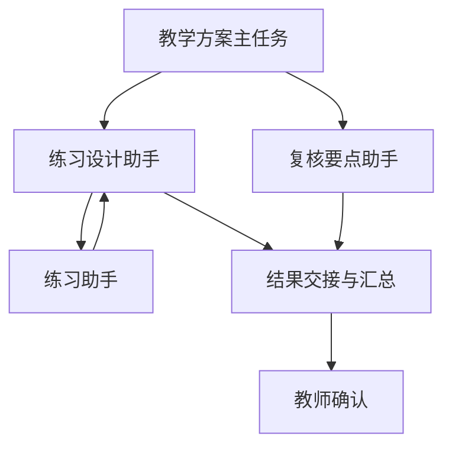

# Harness v3：摘要、并行委派与持久等待

本轮完成上一阶段列出的四项 Harness 工作：模型摘要式压缩、多个子任务并行与汇总、受限多层委派、持久人工等待和定时唤醒。任务适配器用教学方案验证内核，固定评分与教师确认规则继续适用。

## 验收范围

| 项目 | 已接入的行为 |
| --- | --- |
| 上下文压缩 | 先确定性压缩旧错误/重复读取，再按预算请求模型摘要旧 assistant 叙述；完整历史和硬事实保留 |
| 多任务汇总 | 同一回复中的独立委派工具可一起创建子任务，按原调用顺序持久交接后继续模型循环 |
| 多层委派 | 根→设计助手→练习助手，根同时可委派复核要点助手；取消任意中间节点只终止该子树 |
| 持久等待 | 整树暂停、人工回复唤醒、定时唤醒；冻结剩余执行时间，预算不返还 |
| 产品心跳 | Worker 有界扫描到期等待，数据库回执去重；无到期待办时不调用模型 |
| 兼容与恢复 | v3 固定策略，v2/v1/原 rubric 策略继续恢复；旧任务不会自动获得新工具或新等待权限 |

## 模型摘要

`semantic_compaction.py` 与 `context_store.py` 使用 `semantic-assistant-history-v1`。摘要候选仅为旧的、独立的 assistant 叙述；全部 system/user 消息、工具调用与结果、近期八条消息和最近两组工具交互不交给模型重写。先执行已有确定性投影，仍超预算才考虑摘要。硬事实本身超限、没有可摘要叙述、摘要请求本身放不下时，直接返回明确错误。

摘要请求不携带工具 schema，与主任务使用相同模型适配器，扣同一局部和整树模型调用预算。派发事件记录 `purpose=context_summary`、计划和请求哈希；收到结果后验证严格 JSON、全部来源索引/哈希及顺序、实际字符节省，再保存不可变检查点。摘要回复不写入原始 `messages`。摘要格式错误或没有节省时终止，不循环付费重试。网络失败仍按原有有界重试规则处理，已发出但结果未知的调用仍计费。

摘要结果以“不可信历史摘要”进入模型投影，不能成为工具权限或固定教学事实。来源哈希证明来源与恢复一致性，不能证明语义准确性。检查点恢复重新从原始历史重建；成功摘要已提交后重启不再为同一批内容摘要。一次摘要装不下全部候选时可以分批，每批仍受总调用预算限制。

## 并行任务树

新任务 `lesson-plan-parallel` 同时调用练习设计与复核要点助手；设计助手再调用已有 `lesson-practice`。子任务只继承同一授权输入快照及本次委派指令，不继承父聊天历史。主方案必须原样保留两个已验证子产物中的练习和复核要点，最终等待老师确认。

| v3 固定约束 | 值 |
| --- | --- |
| 最大委派深度 | 2 |
| 每树累计子任务 | 8，失败后重建也计数 |
| 同树运行中的子任务 | 2；排队和等待子任务的祖先不占槽 |
| 子任务局部调用上限 | 模型 3、工具 4，同时不能超过父和根限制 |
| 整树调用预算 | 根创建时指定；包括摘要、所有子层及未知结果 |
| 并行示范默认预算 | 模型 12、工具 24；显式传入的更小预算仍生效 |

领取并发槽、预算预留、子任务创建、结果交接、取消均先锁根任务；模型请求不持有数据库事务。多个 Worker 实例可以并行执行，单个 Worker 循环仍逐个执行领取的任务。同树并发上限不能代替吞吐量测试。

成功模拟示范共四个任务，使用 **10 次模型、11 次工具调用**。内部三个任务的 `completed` 仅表示草稿可交接，`confirmed_at` 保持 null，不能通过内部任务确认接口绕过老师。新目录同时保留独立方案和上一版单子任务方案。

## 人工等待与定时唤醒

`waiting.py` 增加 `waiting_input`、`waiting_timer`，只允许老师暂停活动根任务。暂停会一起保存活动后代的原状态、剩余执行时长和重试延迟，关闭 inflight 为未知结果、增加 epoch、释放租约。旧响应因此不能继续写入。终态产物的“等待教师确认”与可恢复暂停是不同状态。

恢复要求同一老师、当前等待 token；同一 token 只有一条不可变 `AgentWake` 回执。人工/定时并发、重复请求、过期 token 和取消后扫描不会重复恢复。恢复不补回预算，截止时间按暂停时的剩余执行时间重建。运行 `harness-worker` 常驻循环即可扫描定时等待；`--drain` 只处理当前可领取工作，不会常驻等未来时间。

老师的唤醒回复作为 user 消息加入根任务。尚未完成的子任务先完成回执配对；尚未执行的旧写入或委派若遇到新回复，则记录 `teacher_input_changed` 工具错误并关闭旧调用，再让模型处理新要求。这样不会把老师的新要求遗留在已结束的旧草稿后面。只读工具可完成后再注入回复。

## API 与迁移

新 API/Worker 要求迁移 **0009**。本轮只迁移隔离测试 schema，业务库仍为 0006。部署时先备份，再执行 `uv run --frozen alembic upgrade head`，重启 API 与 Worker。0009 新增等待状态、等待快照及唯一唤醒回执；已有等待历史时拒绝降级。此前 0008 的子任务和检查点降级保护仍生效。

所有写操作需要 Bearer 身份和 `Idempotency-Key`；路径中的运行须属于当前老师。

| 接口 | 用途 |
| --- | --- |
| `GET /v1/harness/tasks` | 七种注册任务、允许的子任务边和内部任务标记 |
| `GET /v1/agent-profiles?task_type=lesson-plan-parallel` | 并行方案 fake/DeepSeek 配置 |
| `POST /v1/courses/{course_id}/lesson-agent-runs` | `agent_profile=fake-lesson-parallel-agent-v1`，其余沿用教学简报输入 |
| `POST /v1/agent-runs/{root_id}/wait` | `{"reason":"等待补充材料"}`；可选未来的带时区 `wake_at` |
| `POST /v1/agent-runs/{root_id}/wake` | `{"wait_token":"等待响应中的 token","response":"新的教师要求"}`；response 可省略 |
| `GET /v1/agent-runs/{root_id}/waits` | 等待原因、时间、快照哈希和唤醒回执 |
| `GET /v1/agent-runs/{id}/children`、`/context-checkpoints`、`/events` | 子树、压缩和模型/工具审计 |
| `POST /v1/agent-runs/{id}/cancel` | 活动子树取消；暂停期间以根任务取消整树 |

新增任务通过 API 使用；现有细则工作台兼容新增等待状态。本轮没有增加专门的多 Agent 页面。

## Claude Code 参考与验证边界

沿用本地参考树，只读理解机制，未执行或复制该项目实现。该树 README 自述为 source map 恢复版本，不能当作官方受支持源码或完整一致性证明。

| 参考位置（相对于参考树） | 本项目采用的机制 |
| --- | --- |
| `src/services/compact/autoCompact.ts:169`、`:259`、`:313`，`compact.ts` | 摘要独立请求、预算触发、失败停止；本项目额外禁止摘要硬事实 |
| `src/tools/AgentTool/runAgent.ts:369`、`:687` | 完整工具配对、独立上下文、配置中的递归约束 |
| `src/tools/AgentTool/agentToolUtils.ts:599` | 子任务先终止，再交接结果 |
| `src/tasks/LocalAgentTask/LocalAgentTask.tsx:224`、`:288`、`:486` | 原子去重、取消与父子生命周期；本项目使用 PG 根锁、唯一回执及 epoch |

验收覆盖摘要计划/恢复/预算、并行乱序完成与有序汇总、两层委派、部分汇总重启、派发回滚、任意子树取消、并发槽、暂停期间迟到响应、唤醒去重、新反馈阻断旧写入及迁移往返。最新测试结果见 [工程实施记录](IMPLEMENTATION_STATUS.md)。使用随机 `_test` schema、fake 模型和 HTTP mock，不推断真实摘要质量、教学效果或费用。

本次四项 Harness 工程任务已形成可运行实现。自由任务图、任意 Shell/文件工具、跨任务长期记忆、向量检索和真实质量评测仍是独立范围；它们不由此次有限任务目录或测试结果自动成立。
