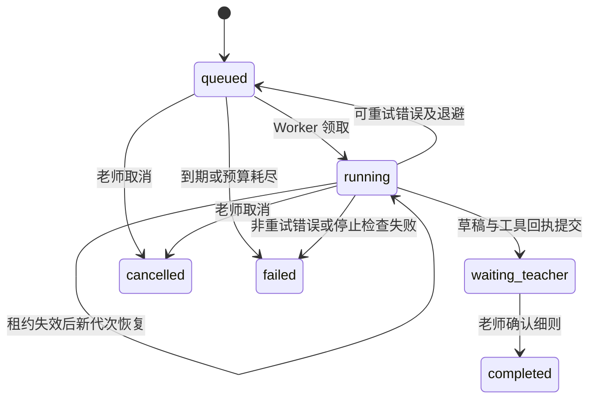

# 评分细则 Agent：实现与验收

日期：2026-10-22，Asia/Shanghai。用户要求继续实现 Agent，并重点参考本机 Claude Code 源码。本轮交付后端工具循环，具体任务为：**读取固定题目 → 模型起草细则 → 程序检查并保存草稿 → 等待老师 → 老师显式确认后完成**。

已有分项评分仍由固定 `GradingRuntime` 执行。新 Agent 不评学生、不修改已确认细则、不确认或发布成绩。默认模拟器只验证工程流程；接入 DeepSeek 需要显式选择。

## 参考了哪些实际代码

本轮定向阅读 `D:/PyChram_project/learn-claude-code-main/claude-code-main/src`，据此独立实现以下机制，没有复制其源码。该目录 README 自述为 source map 恢复树；没有验证其与某个官方发行版完整一致，也没有把外层项目许可视为内嵌代码的许可。

| 参考位置 | 本项目已落地的机制 |
| --- | --- |
| [Tool.ts:369](D:/PyChram_project/learn-claude-code-main/claude-code-main/src/Tool.ts:369)、[Tool.ts:480](D:/PyChram_project/learn-claude-code-main/claude-code-main/src/Tool.ts:480) | `ToolSpec` 注册工具、Pydantic 参数 schema、执行前的参数和对象归属检查；工具调用 ID 与结果关联 |
| [toolExecution.ts:795](D:/PyChram_project/learn-claude-code-main/claude-code-main/src/services/tools/toolExecution.ts:795) | PreTool / PostTool 扩展点；Hook 只能在硬性工具白名单、老师范围内进一步约束执行 |
| [context.ts:112](D:/PyChram_project/learn-claude-code-main/claude-code-main/src/context.ts:112) | 系统规则、老师任务和工具返回分别组装；题目与参考资料作为数据进入工具消息 |
| [query.ts:355](D:/PyChram_project/learn-claude-code-main/claude-code-main/src/query.ts:355) | 每次请求前计算包含工具 schema、历史和工具结果的字符预算；超限显式失败，不截断教学原文 |
| [query.ts:1250](D:/PyChram_project/learn-claude-code-main/claude-code-main/src/query.ts:1250) | 模型说“完成”后仍检查实际草稿；最多一次纠正反馈；接口异常不运行 Stop Hook |

本项目另行实现 PostgreSQL 任务与事件、租约、代次隔离和事务恢复，不能把它们当作对上述源码行为的复刻。EchoMind 本轮没有作为开发底座。

DeepSeek 适配按[官方 Chat Completions 接口](https://api-docs.deepseek.com/api/create-chat-completion/)使用 `tools`、`tool_choice=auto`、assistant `tool_calls` 与同 ID 的 `role=tool` 返回；关闭 thinking，使用非流式单次 HTTP。供应商格式正确后，工具参数仍需经过本地校验。

## 代码与职责

| 文件 | 职责 |
| --- | --- |
| [contracts.py](../backend/src/teaching_assistant/agent/contracts.py) | 任务预算、工具请求和模型回复契约；单条回复最多四个调用，ID 不重复 |
| [models.py](../backend/src/teaching_assistant/agent/models.py) | 模拟适配器、DeepSeek 工具调用适配器；保存请求 ID、实际模型、指纹、usage；不隐藏重试 |
| [tools.py](../backend/src/teaching_assistant/agent/tools.py) | 仅注册 `read_question`、`propose_rubric`；拒绝未知工具、未知参数、重复 JSON 键和非有限数；代码内 Hook |
| [context.py](../backend/src/teaching_assistant/agent/context.py) | 规则、工具 schema、运行版本和模型配置的 manifest；请求预算、精确工具消息 |
| [worker.py](../backend/src/teaching_assistant/agent/worker.py) | 模型与工具循环、领取、取消传播、重试、预算和停止验收 |
| [service.py](../backend/src/teaching_assistant/agent/service.py) / [api.py](../backend/src/teaching_assistant/agent/api.py) | 创建/查询/取消、操作回执、事件查询；老师确认细则时结束等待 |
| [0005_rubric_agent.py](../backend/migrations/versions/0005_rubric_agent.py) | `agent_runs`、追加式 `agent_events` 与事件不可变触发器 |

模型不能传老师、课程或题目 ID 来切换范围。题目版本和老师在创建任务时绑定，工具执行再次检查归属。`propose_rubric` 使用已有业务校验：等级合法、分值单调、最高等级达到分项满分、各分项之和等于题目满分。能否用于教学仍由老师审阅。

## 状态、事务和恢复



- 任务绑定具体题目版本、profile hash 和配置快照。API 与 Worker 需匹配；配置改变不会把旧任务悄悄交给新模型，未匹配任务最迟在到期扫描时失败。
- PostgreSQL `SKIP LOCKED` 领取，写入前检查 owner、epoch、运行状态与租约；模型网络调用不占数据库事务。多个 Worker 可以领取不同任务，同一个任务内工具串行执行。
- 发送模型请求前持久化调用序号并扣预算。恢复时保留已保存的 assistant 工具请求与结果；未知结果记为 `model_unknown`，不会当成零用量或退还额度。
- 草稿写入、PostTool 检查、工具回执、消息检查点及 `waiting_teacher` 在同一事务中完成；PostTool 失败或工具超时回滚草稿写入，错误结果仍按调用 ID 返回。
- 取消中的模型任务会收到本地取消；即使外部回复已经到达，落库仍受代次和状态检查。未完成工具调用补充 `tool_skipped` 与同 ID 的结果。
- 模型重复使用历史工具调用 ID 会失败，避免重复执行。成功保存一份草稿后停止；同一回复剩余工具请求记为跳过。
- 老师通过原有确认接口冻结细则，同时写 `teacher_confirmed` 和 `completed`；确认重试不重复事件。等待老师时不再扫描或调用模型，执行期限也不限制老师何时审阅。
- HTTP 请求和供应商计费无法与本地事务实现全局 exactly-once；网络中断后恢复可能再次调用供应商，账目保留未知状态。数据库内草稿与工具结果则原子提交。

默认预算为 6 次模型请求、10 次工具执行、完整请求 40,000 字符、执行期限 300 秒；请求可在契约上限内调整。自动领取/恢复最多 3 次，退避遵守 `Retry-After`。每次调用还有 `TA_CALL_TIMEOUT_SECONDS`，单个数据库工具有 2 秒超时。字符预算不是精确 token 预算，usage 不完整时不计算虚假的精确费用；输出 token 上限来自 DeepSeek 配置。

事件记录包括 `created / claimed / model_dispatched / model_succeeded / model_failed / model_unknown / tools_requested / pre_tool / post_tool / stop_hook / retry_wait / tool_skipped` 和状态变化。模型成功与失败事件保留可取得的供应商元数据；题目、工具参数及回执属于老师范围内的数据，不能作为公共日志发布。

## 启动和使用

先对目标数据库应用迁移，然后启动 API 和独立 Agent Worker：

```powershell
uv run --frozen alembic upgrade head
uv run --frozen uvicorn teaching_assistant.api:create_app --factory --host 127.0.0.1 --port 8000
# 另一终端，项目根目录
uv run --frozen teaching-assistant agent-worker
```

迁移链到 `0005`，包含此前 `0004` 的指纹字段与回填。本轮仅对测试库随机 schema 执行了迁移，业务库尚未升级。`agent-worker --once` 领取并处理一个可执行任务；`--drain` 处理当前就绪任务后退出，不等待未来重试。原 `worker` 命令仍负责分项批改。

所有接口使用已有 Bearer 身份；POST 必须提供 `Idempotency-Key`，同 key 同请求复用回执，不同内容返回 409。

| 方法和路径 | 用途 |
| --- | --- |
| `GET /v1/agent-profiles` | 查看 `fake-rubric-agent-v1` / `deepseek-rubric-agent-v1`、ready、具体 ID 与 manifest |
| `POST /v1/question-versions/{id}/rubric-agent-runs` | 创建任务，返回 202 与任务 ID |
| `GET /v1/agent-runs?limit=20` | 当前老师最近任务；上限 100，当前没有游标 |
| `GET /v1/agent-runs/{id}` | 状态、草稿 ID、等待条件、预算、尝试数与固定配置 |
| `GET /v1/agent-runs/{id}/events?after=0&limit=100` | 按任务内 sequence 增量查询，返回 `next_after / has_more` |
| `POST /v1/agent-runs/{id}/cancel` | 取消 queued/running；已取消可重复请求，等待复核或其他终态返回 409 |

创建示例：

```json
{
  "agent_profile": "fake-rubric-agent-v1",
  "instructions": "请依据题干和参考答案，起草独立、可区分的评分点与等级。",
  "max_model_calls": 6,
  "max_tool_calls": 10,
  "max_context_characters": 40000,
  "max_seconds": 300
}
```

省略 body 字段即采用模拟器默认值；模拟草稿会明确标注不能视为教学标准。使用真实模型时选择 `deepseek-rubric-agent-v1`，复用现有 `TA_DEEPSEEK_API_KEY / TA_DEEPSEEK_MODEL / TA_DEEPSEEK_EXPECTED_MODEL / TA_DEEPSEEK_REVISION / TA_DEEPSEEK_ENDPOINT / TA_DEEPSEEK_PROXY` 配置。仅配密钥不会自动调用真实模型，未配置时创建任务返回 409。

返回 `waiting_teacher` 后，通过 `GET /v1/rubric-drafts/{draft_id}` 查看 `body` 和 `revision`，再由老师显式 `POST /v1/rubric-drafts/{draft_id}/confirm`，内容为 `{"expected_revision":1}`。若不满意，可用现有手动入口另建细则草稿；本轮未实现 Agent 草稿修改/驳回的网页操作。确认生成的固定版本可用于现有导入、批改、复核和导出链路。

## 验证与下一步

新增 [Agent 集成用例](../backend/tests/test_agent.py) 与 [模型协议用例](../backend/tests/test_agent_model.py)，覆盖：幂等创建、老师确认完成、跨老师隔离、重复 ID、并发领取、多工具结果配对、保存后中断恢复、未知调用预算、取消迟到响应、失败重试、草稿总分修正、PostTool 回滚、上下文与截止时间、有限 Stop 修正、DeepSeek 协议及元数据。

当前回归主要使用 MockTransport、模拟模型及 `teaching_test` 随机 schema；2026-10-22 另做了真实 DeepSeek 验证（见下节）。历史回归不证明草稿教学质量、供应商可用性或成本收益。

## 执行验证（2026-10-22，独立复验）

| 项目 | 结果 |
| --- | --- |
| `ruff check` / `format --check` | 通过；50 个文件格式一致 |
| 后端 `pytest -q` | **105 passed**，75.18 s |
| 前端 Vitest / `tsc` / `vite build` | 22 passed；类型与构建通过 |
| `0003 → 0005` 升级 | 成功；`0004` 回填 4 条历史桩调用（2 评分 + 2 证据），unknown 保持 null |
| 模拟器 run | 2 模型 / 2 工具 / 14 事件 → `waiting_teacher` → 确认后 `completed`（16 事件） |
| DeepSeek 工具协议（本地桩） | 2 次 HTTP 200，事件保留指纹/request id/usage；草稿满分 10.00，确认后完成 |
| 模型预算 | `max_model_calls=1` → 1 模型 + 1 工具后 `agent_model_budget_exhausted` |
| 停止检查 | 只声称完成、不调工具 → 两次拒绝 → `agent_missing_draft` |
| 配置绑定 | Worker 与 run 的 profile 不一致时任务保持 `queued`，未被领取 |
| 幂等/授权/取消 | 同 key 复用 202；异 body 409；跨老师 404；取消 200、重复 200、已完成 409 |

边界：该轮复核时本机尚无 DeepSeek 密钥，Agent 与评分调用均由本地 HTTP 桩驱动；未验证真实供应商行为、跨进程强杀恢复、两个 Worker 实测争抢同一 run，以及草稿教学质量。业务库仍为 `0003`，`alembic check` 明确失败，启用前必须升级。证据见 `.local/e2e/rubric-agent-verification-2026-10-22.md`；随后的真实模型验证见下节。

## 真实 DeepSeek 验证与两处修复（2026-10-22）

`TA_DEEPSEEK_API_KEY` 就绪后用真实模型验证。`deepseek-chat` 是别名，供应商实际返回 `deepseek-flash`，已配置 `TA_DEEPSEEK_EXPECTED_MODEL=deepseek-flash`。

真实结果：compare 2/2、746/27 tokens、建议 10.00；评分批次 2 次调用各 322/22 tokens、指纹 `e72d3c7f…`、建议 10.00；Agent 修复后 2 次调用生成 2 个评分点（5+5=10，等级 0/2/3.5/5），老师确认后 `completed`。

真实运行发现并修复两个本地桩无法暴露的缺陷：

1. **`index` 字段被拒**：DeepSeek 的 `tool_calls` 每项带 `index`，`ToolCall` 的 `extra="forbid"` 使所有真实工具调用被判 `provider_invalid_response`。适配器现在只保留 `id/type/function`，业务契约仍严格；新增回归用例。
2. **等级顺序未说明、错误不可操作**：模型把最高档放在 `ordinal=0`（5/3/1/0），而契约要求 ordinal 0 最低、分值递增；工具只返回 “must match schema”，模型连续 3 次重复后耗尽预算。现已在系统提示与工具描述中写明排序约定，校验错误返回具体字段路径与原因（不返回提交值）；新增回归用例。

全量回归 **107 passed**。真实用量 13 次调用 / 15,418 input / 3,375 output；未配置单价，费用未知。业务库仍未升级。详细记录见 `.local/e2e/real-deepseek-verification-2026-10-22.md`。

后续优先把现有题目页接到这些接口，展示生成进度、草稿、失败原因和老师确认；再用少量真实题目检查 DeepSeek 工具调用与细则质量。通用规划、多 Agent、长期记忆、Shell/HTTP Hook、沙箱、向量检索和产品心跳仍待真实任务驱动，当前没有实现或创建自动化。
